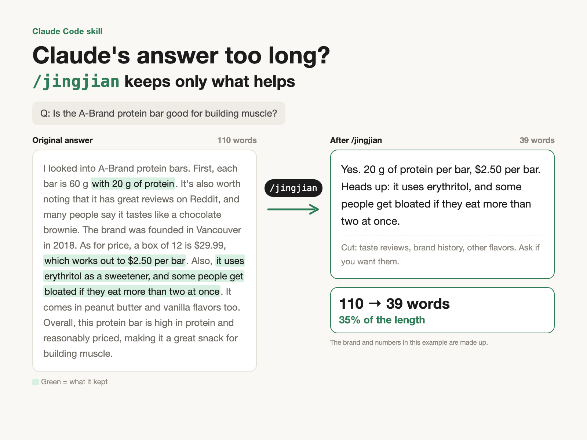

# /jingjian

A Claude Code skill that cuts a long answer down to the points that actually help. "Jingjian" (精简) is Chinese for "cut it down".



## Why I made it

Claude Code's answers are often too long for me. I can understand them, but something that fits on one page, it writes in ten.

(If I can't understand an answer, that's a different problem. For that I use Matt Pocock's [/wait-what](https://github.com/mattpocock/skills).)

First I turned on the official Concise output style and added rules to my CLAUDE.md. But it doesn't work every time. And not every answer needs it. Short answers are fine as they are. So I think it's best if I decide when an answer is too long, and ask for a cut myself.

So I just told it "make it shorter". It did get shorter, but sometimes it cut important points too. Then I tried "keep every fact". It only cut 4 to 15%.

I realized a long answer has maybe 100 points, and only about 15 actually solve my problem. The hard part is the balance: cut a lot, but keep the points that really matter.

## How it works

- It looks at what you asked right before that answer. That's the filter.
- For each point it asks one question: does this help with what you asked this time? If not, cut it.
- It keeps the answer and 3 to 5 main points, plus dates, numbers and risks that would change your decision.
- It keeps every source tag. If it drops them, Claude starts making things up.
- The last line lists what got cut, so you can still ask for it.
- The target is 1/4 to 1/3 of the original. If the result is still over half, it cuts another round.

On 3 real long answers it kept 36 to 47% of the words. My target is 1/4 to 1/3, so I'm still tuning it.

## Install

```bash
git clone https://github.com/Eriq7/claude-code-jingjian.git
mkdir -p ~/.claude/skills/jingjian
cp claude-code-jingjian/jingjian/SKILL.md ~/.claude/skills/jingjian/
```

## Use

When an answer is too long, type `/jingjian` and it cuts down the last answer. You can add a note to narrow it, like `/jingjian just the conclusion`.

It only runs when you type `/jingjian` (it's set with `disable-model-invocation: true`), because most answers don't need it.

## 中文版

Chinese original: [zh/jingjian/SKILL.md](zh/jingjian/SKILL.md). Install it the same way, just copy that file instead.
